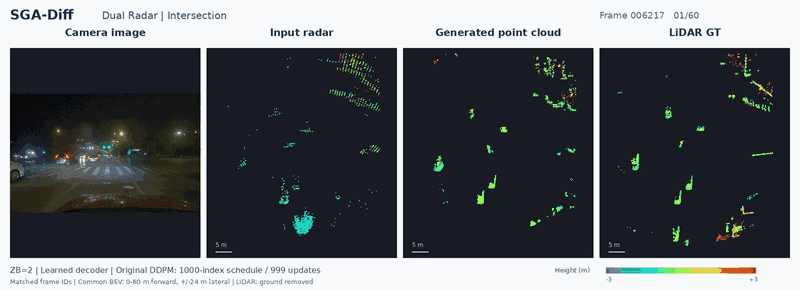

# SGA-Diff · Radar-to-LiDAR

**Diffusion-Based Radar-to-LiDAR Point Cloud Generation via Stratified Gaussian Encoding and Offset-Aware Alignment**

[**Watch the video gallery →**](https://maokang94.github.io/Radar-to-LiDAR/) · [Full-resolution MP4](assets/paper-ddpm1000/dual_zb2_ddpm1000_paper_120.mp4) · [Visualization protocol](#visualization-protocol)

## Paper-model continuous demonstration

**Camera image → Input radar → Generated point cloud → LiDAR GT**

The four columns follow the paper's opening qualitative figure. Each column uses the same frame ID. These are actual saved predictions from the paper's **Dual Radar, 256×256, ZB=2, XY-ODA, geometry-consistent learned decoder** model, with the **original 1000-index DDPM schedule (999 reverse updates)**. These are **not DDIM50** results and do not use the alternative integer-aware decoder.

**120 frames / two continuous 60-frame segments.** Frame order is preserved without dropping intermediate IDs. Playback is10 displayed frames/s, for presentation only—not generation speed.

| Scene | Continuous frames | Watch / download |
|---|---|---|
| Intersection | `006217–006276` | [MP4](assets/paper-ddpm1000/intersection.mp4) · [GIF](assets/paper-ddpm1000/intersection.gif) |
| Urban road | `007120–007179` | [MP4](assets/paper-ddpm1000/urban-road.mp4) · [GIF](assets/paper-ddpm1000/urban-road.gif) |

## Visualization protocol

- **Input radar:** original Arbe and ARS548 returns, transformed with per-frame calibration into the common LiDAR frame.
- **Generated cloud:** unmodified native output of the manuscript Geometry-consistent decoder (`soft_control mixed10`), using the frozen epoch 300 generator's original DDPM tensors.
- **LiDAR GT:** matched ground-removed paper reference. Ground removal is not applied to, or used to correct, generated predictions.
- **Shared BEV:**0–60m forward, ±24m lateral, −3–3m height; forward up, right right. All cloud columns use identical point markers and fixed height colors.
- **Camera:** complete matched front-view image, aspect ratio preserved and no exposure edits.
- **No point-count matching, temporal interpolation, GT-distance filtering or new inference.** Every point inside the shared ROI is rendered.

The [provenance manifest](paper_ddpm1000_manifest.json) records all 120 frame IDs, point counts, source/model/media hashes and visualization settings.

## Model identity

| Component | Frozen model |
|---|---|
| Generator | Pure XY U+S ODA, Dual Radar ZB=2,256×256, epoch 300 |
| Sampler | Original adjacent-step DDPM;1000 noise indices,999 reverse updates |
| Decoder | Manuscript Geometry-consistent decoder,`soft_control mixed10` |
| Generator SHA256 | `bbc005475ac74890ea0dc32ebff53e17377110dc5f092f19a90e606e6318b40e` |
| Decoder SHA256 | `1a0ebee79f9c086bba0d8c7dd53eed9996a545fee6ebbf8b7ea8980ab7b43f62` |

This update publishes derived qualitative media, not model code, weights or the underlying sensor dataset. Earlier preview provenance remains in `showcase_manifest.json` as a historical record; the new manifest above is authoritative for these videos.

## Acknowledgements

Sensor imagery and reference measurements originate from [Dual Radar](https://github.com/adept-thu/Dual-Radar), Zhang et al., *Dual Radar: A Multi-modal Dataset with Dual 4D Radar for Autonomous Driving*. Dataset rights remain with its authors. Obtain raw data from the official distributor and follow its terms. See [DATA_NOTICE.md](DATA_NOTICE.md).
